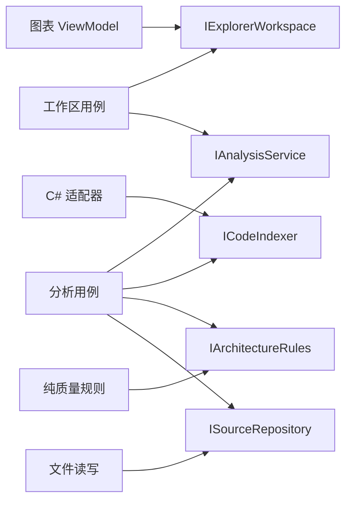

# Code Atlas

独立、本地的 C# 结构与质量工作台。以自身源码作为第一份分析对象。

**功能层级是主导航，技术职责是功能内部的分工。** 主地图按源码分析、代码探索、报告管理、质量检查、运行组装和共享基础组织。按“模块 → 子功能/页面 → 类型 → 方法”进入；实现、界面、契约与 CRUD 跟随其服务的功能，不混为全仓库职责清单。

方法列表显示源码中的用途介绍，详情显示输入参数、返回约定和精确源码位置。搜索也匹配用途。信息缺失时明确显示诊断，不把函数名改写成空泛介绍。

## 架构规范与 LaunchDesk 示例

[架构规范 0.1、现状判断与整理路线](docs/architecture-v0.1.md) 整理功能层级、页面边界、状态与计算、契约、外部作用、主干与可选模块、自分析证据等要求。WPF 顶部“架构规范”直接显示同一份版本化内容，并把当前报告的问题映射到规则，点击证据返回代码地图。未实现或证据不足的检查不会显示为通过。

```powershell
./CodeAtlas.cmd standards
./CodeAtlas.cmd assess --report ./artifacts/reports/launchdesk-reading.json
```

`assess` 是规范与诊断的阅读评估；退出码 0 只说明命令成功，不证明符合全部规范。严格门禁继续使用 `check`。

规范源文件是 [docs/standards/A01.md](docs/standards/A01.md) 到 [A10.md](docs/standards/A10.md)，每项对应一个软件条目，可在窗口查看 Markdown 原文。修改后运行 `python scripts/sync-architecture.py` 生成应用资源；本地构建和 GitHub CI 用 `--check` 阻止文档与软件内容漂移。

[架构条目与源码对应表](docs/code-map.md) 进一步列出每个功能的实现文件、端口、适用规范和当前边界，便于从 MD 直接追到代码。

[LaunchDesk 示例说明](examples/launchdesk/README.md)：从固定 Git 提交读取原始源码，额外提供明确标为人工整理的功能归属；保留全部原始关系、覆盖与问题，不修改 LaunchDesk。若存在该阅读报告，启动脚本优先展示它。

桌面移除了含义模糊的左侧导航。目录与详情之间可拖动调宽，双击分隔条恢复默认；源码摘录和独立阅读窗口默认换行，不需要横向滚动。功能入口分别为“分析仓库”“打开历史报告”“架构规范”“问题与限制”和所选元素的“查看源码摘录（只读）”。

## WPF 桌面版与 CLI（本地试用）

原生 WPF 窗口和独立 CLI 复用同一套分析、规则、报告和探索索引。WPF 不依赖浏览器或 WebView；原有 Web 版继续保留。当前为早期可运行版本，分析与报告保存在本机。

Windows 上安装 .NET 10 SDK 和 Python 3.9+（检查 Markdown 与应用规范是否一致）后，在仓库根目录执行：

```powershell
./scripts/build-desktop.ps1
./scripts/start-desktop.ps1
```

也可以双击根目录 `Start-CodeAtlas.cmd`，首次会自动构建。成品分别位于 `artifacts/desktop/gui/CodeAtlas.Desktop.exe` 与 `artifacts/desktop/cli/CodeAtlas.Cli.exe`；这两个目录是框架依赖版本，运行需要 .NET 10 Desktop Runtime，不能只复制单个 exe。默认优先打开已有的 LaunchDesk 阅读样本，其次是自分析报告；没有报告时，可在窗口选择“分析仓库”。构建脚本只生成本地文件。

桌面默认 1440 × 900，最小 900 × 650；窄窗口收起右侧详情，需要时打开。左侧功能树原地展开，选中只更新详情；底部模块小地图定位主目录，滚动也会同步模块标记。方法详情显示用途、输入输出及带行号的源码快照。独立源码窗口读取报告中的内容，不修改源文件。关系视图聚合真实静态关系，最多展示 80 个根节点、300 条聚合关系；完整目录仍可搜索。质量窗口保留诊断和分析限制。

```powershell
# 不启动 GUI 也可分析、搜索和读取源码
./CodeAtlas.cmd analyze --root C:/YourRepository --id your-repository --reports ./artifacts/reports
./CodeAtlas.cmd inspect --report ./artifacts/reports/desktop-self.json
./CodeAtlas.cmd search --report ./artifacts/reports/desktop-self.json --query ReadAsync

# 控制已经打开的桌面窗口，输出均为 JSON
./CodeAtlas.cmd ui status
./CodeAtlas.cmd ui locate --id atlas.analysis
./CodeAtlas.cmd ui search --query ReadAsync
./CodeAtlas.cmd ui view --mode graph
./CodeAtlas.cmd ui undo
./CodeAtlas.cmd ui redo
./CodeAtlas.cmd ui analyze --root C:/YourRepository
./CodeAtlas.cmd ui cancel
./CodeAtlas.cmd help
```

`ui analyze` 返回任务已接收，完成情况由 `ui status` 的 busy/Error/Status 字段查询；分析失败保留原报告。可用 `ui select --id <搜索返回的ID>` 或 `source --report <文件> --id <ID>` 定位方法。多窗口用启动参数 `--session <name>`（脚本为 `-Session <name>`），CLI 也附上相同 `--session`。控制端点是当前 Windows 用户的命名管道，不开放 HTTP 端口；只接受列出的指令，不执行任意代码。

交互模型采用稳定的 class 实例，子树按需创建，WPF 使用虚拟化与容器复用。撤销/重做保存最多 150 个选择、展开与视图动作，不复制整份报告。换报告会清空旧历史。分析结果仍采用不可变快照，加载新报告才重建索引；滚动、选择和搜索不重新分析源码。

```powershell
./scripts/verify-desktop.ps1
# 额外启动真实 WPF 窗口检查；需要 PowerShell 7（pwsh）和交互桌面
./scripts/verify-desktop.ps1 -IncludeWindow
```

验证输出位于 `artifacts/`，包括核心反例、24,120 个符号的索引夹具、真实窗口与 CLI 联动、GUI/CLI 对同一 WPF 源码的分析一致性。该夹具不等于已证明任意规模下的性能。自分析仍报告缺失文档和不支持项，不能把退出码 0 当作全覆盖。

当前不包含安装器、自动更新、代码编辑、自动重构、运行时 DLL 热卸载或客户授权分发。XAML、生成的 partial 成员和实际项目编译条件仍是明确的分析边界。GUI/CLI 从相同的本机 .NET 参考程序集集合进行语义分析，不依赖各自宿主恰好加载了哪些 WPF 类型；机器上的 SDK/引用版本变化仍可能影响结果。

## Web 版启动与验证

需要 .NET SDK 10.0.400 或同 feature band 的更新版本。首次还原从 NuGet 获取微软 ASP.NET Core 静态资源；Roslyn 取自当前 SDK，不写死安装路径。

在仓库根目录执行：

```powershell
./scripts/verify.ps1
./scripts/start.ps1
```

打开 <http://127.0.0.1:5278>。仅本机监听。停止启动脚本即可停止服务。

验证会构建所有项目（警告视为错误）、运行独立正反例、分析自身、保存 `artifacts/reports/self.json` 和验证记录。`artifacts/` 不进入 Git。

分析采用相同声明的其他仓库：

```powershell
dotnet ./src/CodeAtlas.Host/bin/Debug/net10.0/CodeAtlas.Host.dll analyze --root C:/YourRepository --id your-repository --name "你的项目" --reports ./artifacts/reports
```

`check` 使用相同分析流水线；增加 `--require-complete` 可要求无未声明符号和未支持项；增加 `--require-structured` 可把用途、参数、返回说明和层级缺口作为失败条件。退出码：`0` 完成扫描且无已知规则错误，`2` 规则错误，`3` 严格模式覆盖不完整，`4` 结构/说明规范未满足，`64` 不支持的指令/选项，`1` 执行失败。**0 不等于信息已经完整**，默认模式仍会列出全部结构警告。

## 实际分层

| 项目 | 职责 | 能认识什么 |
|---|---|---|
| `Framework` | 可复用声明属性与枚举 | 基础库 |
| `Contracts` | 图数据、输入输出、操作端口 | 声明框架；不包含业务行为 |
| `Analysis.Core` | 纯架构规则与计算 | 契约；不读文件、不访问界面 |
| `Language.CSharp` | Roslyn 源码适配 | 契约、语言 API |
| `Storage` | 源码读取、报告 CRUD | 契约、文件系统 |
| `Application` | 分析用例与工作区适配 | 各端口；不知道具体存储或解析器 |
| `Presentation` | ViewModel、导航状态、图表展示 | `IExplorerWorkspace` 等契约 |
| `Composition` | 可复用 Fluent 注册扩展 | 声明框架、DI 容器 |
| `Runtime` | GUI/CLI 共用组合根 | 选择分析、存储和用例实现 |
| `Exploration` | 桌面探索索引与可撤销状态 | 契约；不依赖 WPF |
| `Automation` | 当前用户的 GUI 控制协议 | 命名管道与有界 JSON 消息 |
| `Desktop` | 原生 WPF 视图与窗口适配 | 探索状态与操作端口；入口负责组装 |
| `Cli` | 无界面分析、查询与 GUI 控制入口 | 共用运行时、索引和控制协议 |
| `Host` | 本地服务、命令入口与组装 | 选择各实现及生命周期 |
| `Regression` | 独立正反例与自分析 | 可跨层测试 |
| `Desktop.Regression` | 状态、规模夹具与协议回归 | 不需打开窗口 |

默认工作区采用两栏：左侧嵌套结构，右侧用途与源码详情。父模块以卡片包住子功能、类型和成员，在面板宽度内逐层展开；代码目录可按需打开，搜索会自动显示目录。每个节点的关联按钮就地列出真实静态关系，并可直接查看源码证据。

“嵌套结构”和“关系连线”共用展开模型，切换视图保留各分支状态；结构视图按自然文档流展开，后续兄弟分组会顺延，父级标题不跳转。关系视图保留固定节点坐标与拖动操作。

左侧使用原地展开画布：点击卡片只更新目录与详情，点击独立 ＋／− 才展开或收起。父节点、同级节点及已展开分支保持坐标；多条分支可同时展开。收起再展开恢复后代状态。方法是末级详情，不生成空白下级。依赖根据可见节点聚合到最近可见祖先，虚线表示父子归属，箭头保留真实源码证据。

画布展开状态、平移缩放与右侧目录历史独立；搜索、面包屑和返回不会替换左侧地图。下级向右追加，通过横向滚动或拖动查看，不自动移动视野。大型分支每次增加六项，继续展开只追加，不替换已有节点。全局小地图保留模块入口；右侧目录仍可逐层查看功能、类型和方法。



这里的箭头表示静态依赖/接口实现关系，不表示实际运行时间顺序。界面进一步区分类型引用、静态调用、提供方声明和实际注册，避免混为一谈。

## 声明协议 v1

`AtlasFeature` 声明功能目录，`Parent` 是明确父级而不是从 ID 中的点号推断；标识须唯一，父级须存在且无循环。每个节点说明要完成的任务；`Kind = FeatureKind.Page` 还须给出 `Inputs` 和 `Outputs`，说明该页面需要什么、完成什么。

一个项目可给出一个默认归属；类型/方法/属性的 `AtlasComponent` 可覆盖默认值。功能标识可由不同职责、不同 DLL 的代码共同引用，**不以目录或项目名推断功能**。目录可放在仓库内集中维护，也可分布声明，但同一功能只保留一份权威定义。

```csharp
using CodeAtlas.Framework;

[assembly: AtlasFeature("e3d.launch", "E3D 启动", "准备并执行启动任务", Kind = FeatureKind.Module)]
[assembly: AtlasFeature("e3d.launch.plan", "准备启动计划", "根据安装位置构造启动信息", "e3d.launch")]
[assembly: AtlasModule("e3d.launch.plan", "启动计划", ArchitecturalRole.Application)]

/// <summary>启动计划的计算契约，不负责实际创建进程。</summary>
[AtlasComponent("e3d.launch.plan", ArchitecturalRole.Contract)]
public interface ILaunchPlan { string Build(string installation); }

/// <summary>从安装位置构造启动目标，不接触界面或文件系统。</summary>
[AtlasComponent("e3d.launch.plan", ArchitecturalRole.Feature)]
[AtlasProvides(typeof(ILaunchPlan))]
public sealed class LaunchPlan : ILaunchPlan
{
    /// <summary>组合安装目录与可执行文件名称。</summary>
    /// <param name="installation">已选择的安装目录。</param>
    /// <returns>供外部进程适配器使用的目标路径。</returns>
    [AtlasOperation(EffectKind.Pure)]
    public string Build(string installation) => installation + "/e3d.exe";
}
```

示例只说明声明和分层，不是已经实现的 E3D 启动器。启动进程、许可查询等外部作用应放到相应端口适配层，由用例组合。

组合根引用 `CodeAtlas.Composition` 后可注册：

```csharp
services.AddAtlas<ILaunchPlan, LaunchPlan>();
```

编译器约束实现必须满足契约；运行时注册要求显式 `AtlasProvides`，重复提供同一端口会失败。当前生命周期为 singleton；工厂重载可接入配置。自定义生命周期、反射发现 DLL、热插拔和分发授权尚未实现，不能据此宣称插件可安全热卸载。

ViewModel 接收 `IExplorerWorkspace`：后端提供图数据和可用动作，ViewModel 只管理选择、过滤、导航、视角和动作派发。回归测试用独立“几何重新计算”动作证明其不依赖分析服务实现。契约仍是图工作区契约，不是任意应用界面的通用生成器。

## 质量规则

| 规则 | 含义 |
|---|---|
| AT001 | 未声明职责，保留待整理，不能自动视为核心 |
| AT002 / AT004 / AT005 | 默认声明冲突 / 非法职责 / 非法作用 |
| AT003 | 提供方未实现其声明的接口 |
| AT010 | 已声明职责，但没有登记功能层级 |
| AT011 / AT013 | 功能名称/用途缺失，或父级缺失、重复、循环 |
| AT012 | 类型/方法缺少 XML summary 用途说明 |
| AT014 | 同一类型、同一子功能下超过 30 个方法，需继续组织 |
| AT015 | 页面没有明确输入或完成结果 |
| AT016 / AT017 | XML 文档不可解析，或方法的参数/返回含义缺失 |
| AT101 | 功能、交互、数据、适配、用例之间直接越层；应通过契约连接 |
| AT102 | 功能核心或显式 Pure 成员直接使用已知 IO、时钟、随机数等外部作用 |
| AT103 | Pure 方法调用显式 ExternalRead/ExternalWrite/Interaction 契约 |
| AT104 | 契约中含方法体或计算属性实现 |
| AT200–AT210 | 不支持的语言、读取/编码问题、构建条件、运行时目标、无法确认语义等 |

当前边界策略较严格：核心只允许同职责、契约和框架依赖。组合根与测试可跨层。它是明确的团队组织约定，不是“所有 C# 程序必须如此”的语言规则；声明本身不证明其命名/归属正确。

## 分析边界与完整性

- 基于 Roslyn 的 C# 14 源码视图，不执行被分析项目、不求值 MSBuild、不加载它的程序集、不运行生成器。
- 在一个合成编译中绑定源符号；不还原真实多项目编译环境。外部包、条件编译、缺失引用等会作为明确限制报告，不冒充项目实际编译失败。
- 显式类型、方法、构造函数、属性、字段、事件可索引；局部变量、自动生成成员、Razor 生成部分不是完整模型。partial 类型以一个主位置展示，其他部分原文保留。
- 接口调用只连接到接口；提供方和注册另立证据。委托、动态、反射的运行目标不猜测。完整运行时调用图和完整函数纯度证明暂不支持。
- 扫描 `.cs/.razor/.xaml/.js/.ts/.tsx/.jsx/.py/.cpp/.h/.vb/.fs/.csproj/.ps1`。除 C# 外保留原文并显示未支持；其他扩展名不纳入本轮源文件统计。
- 排除 `.git/bin/obj/artifacts/node_modules/packages/.vs`，不跟随重解析点。文件读取失败或编码不明保留明确缺口；原文件不修改。
- 当前无自动重构和旧声明格式迁移。LaunchDesk 旧格式需要显式适配，不能静默按新规则认证。
- 软件没有报告云同步或自动远程发布；源码仓库公开与用户的本地分析数据相互独立。

## 自回归为何不只是“自己说自己通过”

`tests/CodeAtlas.Regression` 除了分析本仓库，还独立构造有问题的代码：把 ViewModel 的接口替换为核心实现、把 IO 塞入核心、伪造纯计算、把行为放进契约等。测试要求这些反例被拒绝，同时验证正常端口组合不被误报。

还验证报告 CRUD、取消写入保持旧报告、错误文件不被覆盖、搜索/地图/滚动位置返回、未知动作保持当前工作区、注册约束，以及完整图不存在悬空关系。

浏览器脚本 `tests/browser-check.cjs` 需要 Playwright 和已启动的本地服务。可设置 `PLAYWRIGHT_MODULE` 为已有安装路径、`BROWSER_EXECUTABLE` 为本机浏览器；默认使用普通 Playwright 安装。测试截图和结果写入 `artifacts/`。

`tests/structure-check.cjs` 验证默认两栏、深层嵌套、选中高亮、关联证据、目录搜索和窄窗口边界。`tests/focus-map-check.cjs` 验证选中与展开分离、父节点屏幕位置不变、多分支保留、收起后恢复、目录历史不换图及末级方法详情，并保存实际截图。独立回归夹具覆盖增量添加和报告替换时清理旧分支。

地图拖动在浏览器按帧绘制，结束时提交一次位置；普通鼠标移动不调用后台。功能索引、模块连线按报告实例缓存，局部查询按报告实例和筛选条件缓存。报告使用 `record` 保存快照，但缓存失效通过 `ReferenceEquals` 判断报告是否替换，不依赖报告的值比较。诊断分组展开后才生成明细，每次增加最多 50 项。

`tests/performance-check.cjs` 记录固定鼠标移动、拖动和模块切换的通信量与耗时；设置 `ATLAS_PERF_LABEL` 可保存前后对照，设置 `ATLAS_PERF_VERIFY=1` 还检查拖动即时绘制、返回保留位置和诊断增量加载。切换耗时包含浏览器自动化等待，属于本机对照测量，不代表所有规模仓库的性能保证。

当前是可运行的首版架构基线：不把未支持项屏蔽成“全绿”，也不把自分析等同于完整安全、性能或业务正确性证明。
