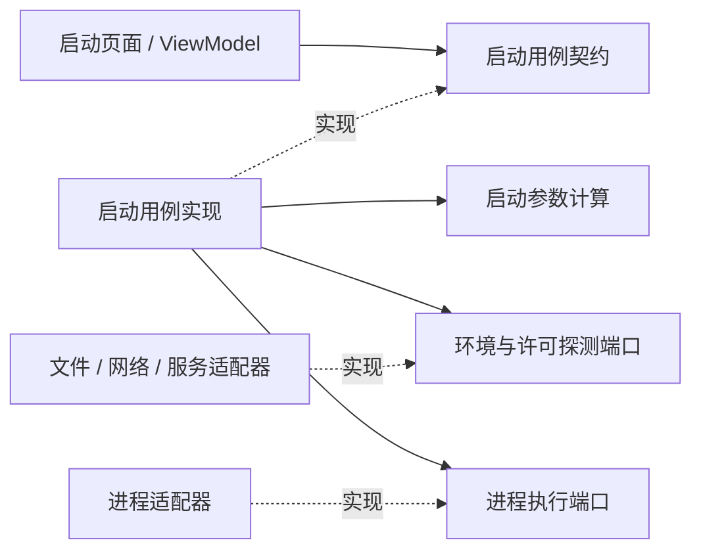

# Code Atlas 架构规范 0.1：讨论基准与整理路线

这份规范用于审阅和渐进改造，不宣称现有项目已经符合。**Markdown 是规范源文件**：[A01](standards/A01.md) 到 [A10](standards/A10.md) 每项一个文件，[索引](standards/index.md) 维护版本、目标与迁移路线。软件中的“架构规范”窗口和 CLI `standards` / `assess` 读取由 Markdown 生成的 [版本化资源](architecture-standard.v1.json)，每项显示对应文档路径，桌面可直接阅读随程序打包的 Markdown 原文。

修改 Markdown 后运行 `python scripts/sync-architecture.py`。构建脚本和 GitHub CI 执行 `--check`，文档与软件内容不一致时失败。本文解释设计取舍与 LaunchDesk 的迁移方法。

## 1. 首先约定：功能与职责是两个维度

主目录按用户任务组织：**产品 → 模块 → 子功能或页面 → 职责 → 类型 → 操作**。功能归属不等于程序集、文件夹或类名；一个功能可能跨多个项目，一个类型也可能暂时混合多个功能。

在每个具体功能内区分：

| 职责 | 负责什么 | 不应承担什么 |
|---|---|---|
| 功能实现 | 当前功能的规则、计算、决策 | 页面状态、文件或进程操作 |
| 页面交互 | 当前页面的选择、表单、验证反馈、命令与显示 | 具体后端实现和直接外部执行 |
| 契约 | 用例/能力端口、请求、结果、输入输出语义 | 默认业务实现或 UI 控件类型 |
| 用例编排 | 顺序、取消、失败处理及跨能力协调 | 控件布局或各适配器的底层细节 |
| 数据与外部适配 | CRUD、文件、网络、系统服务、进程或渲染设备 | 隐藏的全局业务规则 |
| 组合入口 | 选择实现、生命周期、可选模块与注册 | 把所有业务塞进注册中心 |

**功能实现是功能视角的核心；ViewModel 是交互视角的核心。** 两者通过契约协作，各自保持内聚。“辅助”是相对调用场景而言，不是某段代码永久低一等。共享能力也可以拥有自己的独立功能核心。

不要用一个 `Core` 项目包揽所有功能，也不要机械地把所有 ViewModel、接口或 CRUD 聚合成一个扁平入口。项目可以作为物理边界，地图需要另外表达功能边界。

## 2. 类的状态与操作的作用分别声明

- 有状态对象：说明所持数据、唯一所有者、生命周期、修改入口、通知、线程或并发约定。
- 无状态计算：输入显式、输出明确；不暗读全局状态，不借由依赖偷偷访问文件、网络或设备。
- 外部作用：明确读、写、交互和失败方式；放在可替换端口后面。

同一个类可以既持有状态又调用纯计算。地图应把“对象管理什么数据”和“某个方法会做什么”分开显示。`static` 不证明纯计算，`class` 不自动代表有状态，`record` 也不天然无法承载大数据。

大规模交互使用稳定 class、局部通知、缓存索引、按需呈现和有界 Undo/Redo。不可变分析快照仍可用 record；禁止的是无必要的全图复制、深比较与全量重绘。当前 Undo/Redo 只撤销浏览动作，不是文件编辑撤销。

## 3. 主干、注册与可选 DLL

宿主知道稳定契约与模块协议。模块声明 ID、版本、能力、页面、必需依赖和可选依赖。组合根用 Fluent API 把实现接到端口上；注册中心管理发现、校验与组合，不管理全部函数。

普通内部方法无需逐个注册。只有需要独立调用、定位、测试或组合的能力才需要明确元数据。功能层级可以很深，程序集数量不必与层级一一对应。

可拆分需要至少验证：

1. 公共入口不强引用私有许可或 AI 实现；确需协作时通过稳定契约与能力可用性表达。
2. 移除可选模块后，剩余依赖闭包仍能构建并启动；必需依赖缺失必须报出原因。
3. 客户包实际不含不需要的 DLL、配置和资源；仅隐藏菜单不算移除。
4. GUI 与 CLI 复用能力和规则。CLI 不依赖一个必须打开的 GUI 才能分析。

第一阶段采用**构建时选择与启动时组装**。运行时热卸载还涉及事件订阅、线程、资源、服务生命周期与程序集加载上下文，是独立需求。0.1 基线没有模块清单验证；后续 [0.2](architecture-v0.2.md) 已增加显式启动模块、Profile 与能力版本校验，DLL 分发闭包和热卸载仍未实现。

## 4. 地图应该回答的问题

每个功能说明目的、触发者、输入、输出和作用。每个页面说明它管理的状态和调用的用例。每条关系说明是类型引用、静态调用、契约实现、注册，还是实际运行证据。

节点保留稳定 ID、文件/方法/行号和信息来源。来源至少区分：源码自声明、人工阅读映射、静态分析事实、暂不支持。反射、动态调用和 XAML 绑定不能猜成已解析。

无声明代码仍进入待整理区；无说明显示缺失；无功能显示未实现；未知不是通过。源码跳转先提供只读快照摘录，不能假装已接通编辑器修改和保存。

## 5. 当前符合性判断

| 对象 | 判断 | 原因 |
|---|---|---|
| 目标架构 | 可以满足这套规范 | 功能层级与技术职责正交；稳定端口允许 GUI/CLI 和可选实现并存 |
| LaunchDesk 固定提交 `890cc463106358f8643592d99ddd14601fb09593` | 部分符合，需要真实重构 | 有具体业务类与界面，但部分计算、文件访问、页面状态和执行流程仍混合，源码也未采用 Atlas 声明 |
| Code Atlas 当前实现 | 有可用基础，尚非完整验证器 | 已分离规则、解析、存储、契约、组合、GUI/CLI；仍有说明缺口和语义限制，可选模块分发等未实现 |
| LaunchDesk 人工功能图 | 阅读辅助，不能视为符合认证 | 没有改变原始源码、关系、覆盖统计；人工归属不会变成“源码已声明” |

LaunchDesk 示例保留 57 个被扫描文件、762 个符号与 3,135 条已解析静态关系。原始源码声明计数仍为 0。人工清单映射了 396 个符号，其余 366 个仍保留；不是全部代码已正确分类的证明。样本来自固定本地 Git 提交，排除了此前未提交的原型，未声称是远端最新状态。

具体问题：

| 证据 | 现状 | 规范差距 | 建议 |
|---|---|---|---|
| `LaunchDesk.Core/LaunchService.cs:26`，`Build` | 调用 `Validate`，访问文件/目录，然后组装启动参数 | 计算和环境检查耦合 | 提取参数规则和校验端口；当前不要标为 Pure |
| `LaunchDesk.App/MainViewModel.cs:240`，`LaunchAsync` | 许可探测、工具环境、`Process.Start`、页面通知在一起 | 页面状态与用例/外部执行混合 | ViewModel 接收启动用例契约，进程执行交给适配器 |
| `LaunchDesk.Core/WorkspaceStore.cs:6` | JSON CRUD、配置验证、克隆、导入合并共存 | 数据访问与规则未分清 | 拆出存储适配器、配置规则和导入用例 |
| `LaunchDesk.Core/LicenseMonitor.cs:8`，`CheckAsync` | 检查端口或本机服务 | 不能证明实际许可签出 | 把“连接可达”与“许可签出成功”明确区分 |

本提交未发现可作为已实现模块展示的 AI / PmlTrigger 集成。它们保留为未来能力，不伪造进地图。

## 6. 按规范整理架构的方法

从一个完整的用户任务开始，不先大批移动文件。建议先整理“选择配置 → 检查 → 启动 E3D”。

这是**建议的目标结构**，图中端口与拆分实现尚未添加到 LaunchDesk。实线是依赖，虚线是实现关系，不表示当前运行轨迹。

迁移顺序：

1. 固定现有行为测试与源码提交，记录原始诊断。
2. 给用户任务和页面命名，整理功能树与状态所有者，未知项继续保留。
3. 列出当前调用链的真实方法、数据和外部作用。
4. 提取最小契约；请求和结果不引用 WPF 或具体存储对象。
5. 拆出纯计算及外部适配，用例协调顺序、失败与取消。
6. 页面 ViewModel 改为只依赖用例端口；用假的后端验证交互。
7. 在组合根接线，验证模块删除、替换及客户包实际内容。
8. 逐步补充真实源码声明，替代人工归属；保留定位与历史对照。
9. 运行行为回归、独立坏例、覆盖与性能检查。每步可回退，之后再迁移下一个功能。

改类名、改文件夹或新增几个接口，均不足以单独证明完成迁移。

## 7. 软件中的呈现与当前边界

WPF 顶部“架构规范”提供三部分：

- **规范与符合性**：10 项规则，每项显示要求、原因、检查范围、整理建议、验收条件和当前报告证据。点击证据返回对应源码。
- **整理路线（待执行）**：真实迁移顺序，明确尚未执行自动重构。
- **已实现与不支持**：公开当前能力、原始报告限制和人工映射说明。

自动判断采用保守文案：存在问题、证据不足、需要人工验证、未发现已知问题仍需确认。不会输出虚假的完整通过率。`assess` 的退出码 0 仅表示评估命令执行成功；持续集成的规则门禁仍用 `check` 及严格选项。

FigCraft 同步展示规范、证据、整理路线、源码换行和两档面板宽度交互；连续自由拖动与真实分析在 WPF 中实现。该原型不是自动重构工具。
