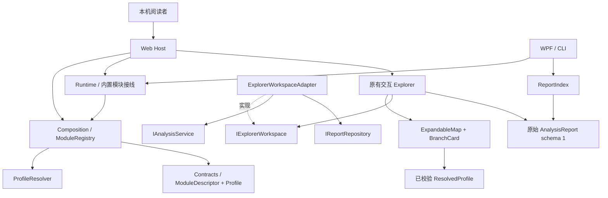

# C4：启动模块与既有探索界面

系统上下文：本机阅读者使用 CodeAtlas，分析源码文件并读取本机报告。GitHub 是源码协作系统，用户报告不会因模块启动而上传。

容器视图：Web Host / WPF / CLI 仍为入口；共用 Runtime、分析流水线与报告存储。以下为 C4 Level 3 组件依赖图，不是调用轨迹。

动态步骤：宿主登记目录 → 选择 Profile → 校验父级/依赖/版本 → 接线 → 构建容器 → 解释已知 ViewContribution → 现有 Explorer 加载原始报告。切换到运行模块视角只读启动快照；展开、收起、选择沿用既有组件，不触发源码重新分析。

物理边界：Contracts 不引用 UI、Composition 或 Runtime；Composition 只依赖协议与 DI；Runtime 选择实现；Host 负责 Web 视图映射。模块树的深度不要求新增对应数量的 csproj。
