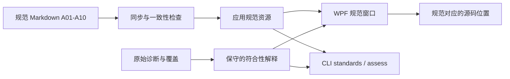

# 架构条目与源码的对应关系

本页记录 **Code Atlas 已实现的结构**。规范源文件位于 [standards](standards/index.md)，目标架构和 LaunchDesk 的待执行整理方案见 [架构说明](architecture-v0.1.md)。实现存在不代表全部符合规范，缺口仍由报告和回归检查揭示。

| 功能/边界 | 实现与契约 | 对应规范 | 已知边界 |
|---|---|---|---|
| 声明功能、职责与作用 | [声明属性与枚举](../src/CodeAtlas.Framework/Declarations.cs)、[功能目录](../src/CodeAtlas.Host/FeatureCatalog.cs) | [A01 功能层级](standards/A01.md)、[A05 状态与计算](standards/A05.md) | 声明不证明归属合理或计算纯度 |
| 编排一次分析 | [AnalyzeRepository](../src/CodeAtlas.Application/AnalyzeRepository.cs)、[操作端口](../src/CodeAtlas.Contracts/Ports.cs) | [A02 功能实现](standards/A02.md)、[A04 契约](standards/A04.md) | 不执行被分析项目，也不还原完整 MSBuild 环境 |
| 盘点与保存源码/报告 | [SourceRepository](../src/CodeAtlas.Storage/SourceRepository.cs)、[JsonReportRepository](../src/CodeAtlas.Storage/JsonReportRepository.cs) | [A06 数据与外部适配](standards/A06.md) | 原文快照不保证与磁盘当前版本一致 |
| C# 语义解析 | [CSharpIndexer](../src/CodeAtlas.Language.CSharp/CSharpIndexer.cs)、[IndexSession](../src/CodeAtlas.Language.CSharp/IndexSession.cs) | [A08 证据与盲区](standards/A08.md) | 反射、动态目标、生成代码和 XAML 仍有限制 |
| 独立架构规则 | [ArchitectureRules](../src/CodeAtlas.Analysis.Core/ArchitectureRules.cs)、[FeatureStructureRules](../src/CodeAtlas.Analysis.Core/FeatureStructureRules.cs) | [A02](standards/A02.md)、[A04](standards/A04.md)、[A10](standards/A10.md) | 规则覆盖有限；没有报错不等于完整认证 |
| 桌面浏览状态 | [ExplorerSession](../src/CodeAtlas.Exploration/ExplorerSession.cs)、[ExplorerItem](../src/CodeAtlas.Exploration/ExplorerItem.cs)、[ActionHistory](../src/CodeAtlas.Exploration/ActionHistory.cs) | [A03 页面边界](standards/A03.md)、[A09 性能与历史](standards/A09.md) | 历史只处理浏览动作，不编辑源码 |
| 功能索引与搜索 | [ReportIndex](../src/CodeAtlas.Exploration/ReportIndex.cs) | [A01](standards/A01.md)、[A08](standards/A08.md)、[A09](standards/A09.md) | 大关系图有显示上限，完整元素仍在搜索与目录中 |
| WPF 视图与工作区端口 | [MainWindow.xaml](../src/CodeAtlas.Desktop/MainWindow.xaml)、[DesktopWorkspace](../src/CodeAtlas.Desktop/DesktopWorkspace.cs) | [A03 页面边界](standards/A03.md) | 仍是早期桌面布局，不是通用 UI 生成框架 |
| Markdown 规范与符合性阅读 | [ArchitectureGuide](../src/CodeAtlas.Exploration/ArchitectureGuide.cs)、[ArchitectureWindow](../src/CodeAtlas.Desktop/ArchitectureWindow.cs)、[同步脚本](../scripts/sync-architecture.py) | [A08](standards/A08.md)、[A10](standards/A10.md) | 解释现有诊断，不执行自动重构；未实现检查明确显示 |
| CLI 与本机 GUI 控制 | [CLI](../src/CodeAtlas.Cli/Program.cs)、[控制协议](../src/CodeAtlas.Automation/ControlProtocol.cs)、[桌面服务](../src/CodeAtlas.Desktop/DesktopControlServer.cs) | [A03](standards/A03.md)、[A07](standards/A07.md) | 当前用户本地管道，不是远程管理服务 |
| Fluent 注册与共享组装 | [AtlasRegistration](../src/CodeAtlas.Composition/AtlasRegistration.cs)、[AtlasRuntime](../src/CodeAtlas.Runtime/AtlasRuntime.cs) | [A04 契约](standards/A04.md)、[A07 模块](standards/A07.md) | 已有明确端口注册；完整可选模块清单、分发和热卸载未实现 |
| 独立反例与自身分析 | [核心回归](../tests/CodeAtlas.Regression/Program.cs)、[桌面状态回归](../tests/CodeAtlas.Desktop.Regression/Program.cs)、[验证脚本](../scripts/verify-desktop.ps1) | [A10 自回归](standards/A10.md) | 本地交互测试与 CI 无窗口测试范围不同，均非任意规模性能证明 |

## 文档到软件，再到证据

修改规范先编辑对应 MD，再生成资源并运行回归。修改实现时同步维护此表；增加尚未实现的架构能力时，先写清要求与“不支持”的状态，不能用空结果宣布通过。
